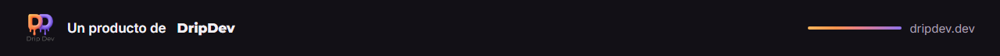
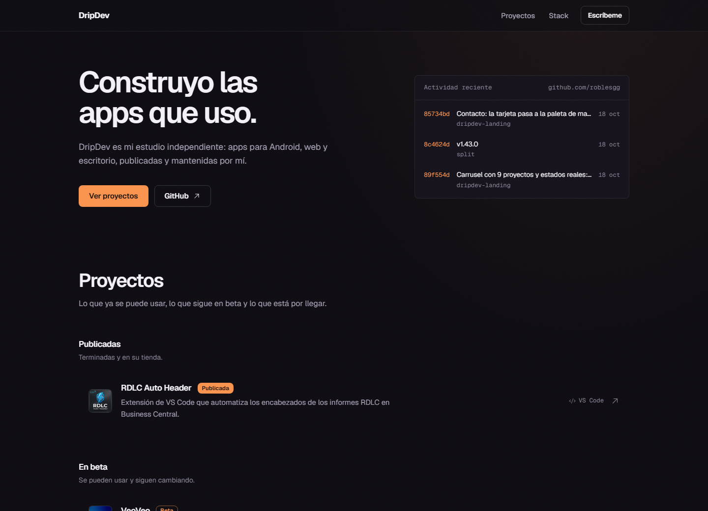

<a href="https://dripdev.dev"></a>

<p align="center">
  
</p>

<p align="center">
  <a href="https://dripdev.dev"></a>
  
  
</p>

La web de **DripDev**: quién hay detrás, qué productos hay y cómo contactar. Está pensada para quien quiera valorar el trabajo, así que enseña datos reales en lugar de adornos.

## Qué tiene

- **Portada** con la actividad reciente de GitHub: commits reales, con su hash y su fecha.
- **Proyectos**, agrupados por estado (publicados, en beta y próximamente). Cada uno con sus plataformas y, si tiene versión publicada, la versión y su fecha.
- **Con qué lo construyo**: el stack real, sacado del inventario de tecnologías de DripDev.
- **Sobre mí y contacto.**

## De dónde salen los datos

- **Estados, textos y enlaces de los proyectos:** `src/lib/proyectos.ts`. Es el único sitio que hay que tocar para añadir un proyecto o cambiar su estado. Los estados los decide Álvaro, no se deducen.
- **Versiones, fechas y commits:** la API pública de GitHub, pedida en el servidor y cacheada una hora. Si GitHub no responde, ese dato simplemente no se muestra: no se inventa nada.
- **Por qué la fecha es la de la versión y no la del último push:** un cambio en el README no es una versión, y mostrarlo como "actualizado" engañaba.
- **Qué no se enseña de la actividad:** los commits de VeoVeo (trabaja en ramas `play/*` con notas internas), las fusiones y las notas de trabajo con agentes.

Opcional: define `GITHUB_TOKEN` (solo lectura) para subir el límite de la API de 60 a 5000 peticiones por hora.

## Hecho con

Next.js 16 y React 19, Motion para las animaciones, Phosphor para los iconos y Geist (texto y datos). Tema oscuro fijo. Publicada en Vercel: cada fusión a `main` se despliega sola.

<details>
<summary><b>Para desarrollar</b></summary>

<br>

```bash
npm install
npm run dev      # http://localhost:3000
npm run build    # comprueba tipos y genera la web
```

</details>

---

<p align="center"><sub><b>DripDev</b> · hecho por Álvaro Robles</sub></p>
