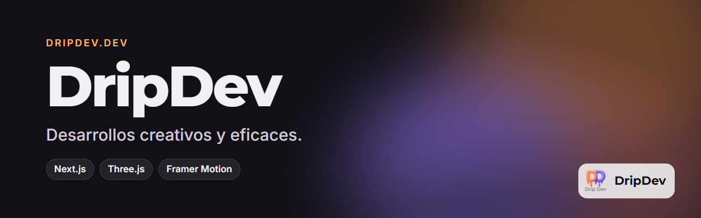
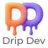

<p align="center">
  
</p>

<p align="center">
  <a href="https://dripdev-landing.vercel.app"></a>
  
  
</p>

La web de **DripDev**: quién hay detrás, qué productos tiene y cómo contactar. Los proyectos se presentan en un carrusel 3D que puedes girar.

<!-- Captura: añade docs/capturas/web.png y descomenta.
<p align="center"></p>
-->

## Qué tiene

- **Portada animada** con el logo de la marca.
- **Carrusel 3D de proyectos** con cada producto de DripDev.
- **Sobre mí y contacto.**

## Hecho con

Next.js y React, React Three Fiber y drei para el 3D, y Framer Motion para las animaciones. Publicada en Vercel.

## Desarrollo

```bash
npm install
npm run dev      # http://localhost:3000
```

---

<p align="center">
  <br>
  Un producto de <b>DripDev</b> · hecho por Álvaro Robles
</p>
